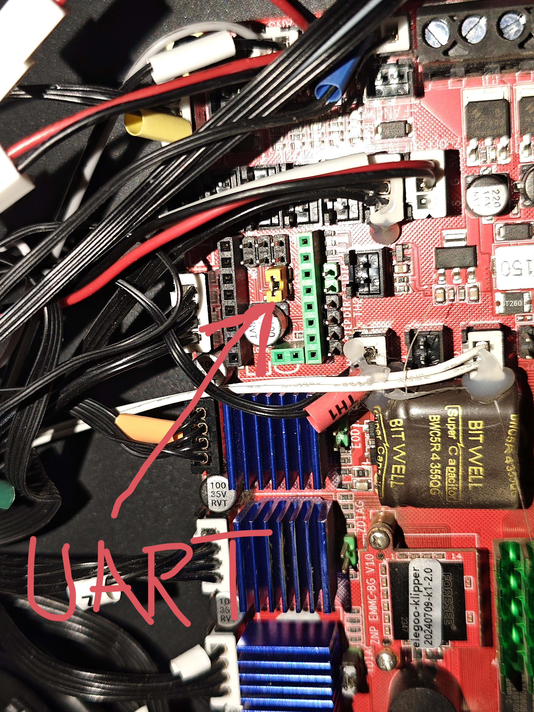
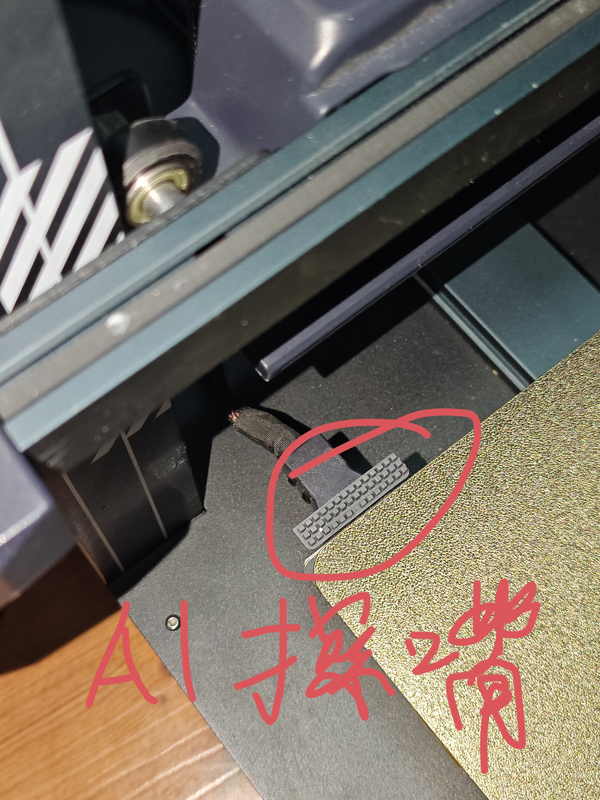

# Neptune 4 Max AI 改装参考项目

面向海王星 4 Max / ZNP K1 V2.0 的改装思路、定制源码、参考配置与 AI 接手指南。

本项目把一台长期使用的机器上逐步完成的改装整理成可阅读、可审查的工程资料。你可以把项目交给 Codex 等智能体，让它先检查你的机器，再按你选择的功能生成改动、完成备份和逐项验证。这里不提供一键覆盖原厂配置的安装器。

**参考机器由机主确认运行正常。另一台未经改装的原装 4 Max 尚未完成整套复刻验收。** 本仓库中的坐标、方向、电流和接触窗口有单机标定数据，不能直接作为所有 4 Max 的通用值。

**上电或重启 Klipper 后，先真实归位，再移动 XYZ 或校准床网。** 原厂启动流程可能写入默认工具头坐标，使界面显示的位置及“已归零”状态与实际位置不符。用户在本次启动尚未完成真实 Home 时，不要随意操作工具头移动，也不要点击网页端“校准床网补偿”按钮。智能体必须在每次上电、`RESTART`、`FIRMWARE_RESTART` 或 Klipper 服务重启后重新确认真实 `G28` 成功，才能执行后续 XYZ 移动；仅检查 `homed_axes` 不够。归位前也须检查路径、间隙及探针条件，详见[上电与重启后的归位规则](docs/validation.md#上电与重启后的归位规则)。

## 能获得什么

| 功能 | 作用与实现 |
|---|---|
| 独立双 Z 与龙门自动校正 | 增加 MKS TMC2209 V2.0，通过原 Z 和 E1 分别驱动两侧丝杆；PA11 接近开关测量左右各三个相邻点，`Z_TILT_ADJUST` 校正两侧高度后重新归零 Z |
| 打印前自动测量喷嘴 Z 偏移 | 复用原厂工具头 ADXL345，以三次喷嘴接触的中位数和接触点床网值计算临时 offset；PA11 继续负责日常归零和床网 |
| 热稳定、排料与硅胶条擦嘴 | 按首层床温等待连续稳定，先热擦、再降温擦；正式接触测量使用绑定当前文件的一次性擦嘴会话 |
| 自适应床网 | 根据 Bambu Studio 首层范围测量必要区域，保留 ADXL 接触区域覆盖；支持明确标记的 PA 校准线段范围解析 |
| 独立辅助散热风扇 | 主风扇在 FAN2/PB7，辅助风扇在 FAN3/PC9；Bambu `M106 P2` 单独控制辅助风扇 |
| 驱动专用散热风扇 | 从共用热端散热输出的 FAN6/PC7 移至 FAN4/PA8；任一电机通电时全速散热，全部释放后延时 60 秒关闭 |
| 主风扇比例映射 | 输入 0～100% 映射到 0～70% PWM，保留整个调节范围；辅助通道仍可输出 100% PWM |
| 冷拔维护 | 归零、Z200、250°C 排料 150 mm，再降至 110/90°C 回抽，释放挤出机电机，保持 90°C 并响两声 |
| Bambu 元数据适配 | 补齐旧 Moonraker 对 Bambu 文件层数、层高、模型高度和预览的识别；当前层由对应旧版 Fluidd 根据 Z 估算 |
| 老软件兼容 | 保留原厂 Klipper/Python 环境，提供 `autotune_tmc` 的 Python 2 和旧 Klipper 接口适配源码与补丁 |

减少手动重复找平和准备工作是目标；首层、墙体和散热效果仍取决于机械状态、材料和校准。软件不会矫直弯曲丝杆，也不能替代热床机械整平。

## 硬件改了哪些地方

- 拆除顶部 Z 同步皮带和两根丝杆上的同步带轮。带齿、装在丝杆顶部的轮子称为**同步带轮**。
- 主板 E1 插入 **MKS TMC2209 V2.0**；本机模块两颗采样电阻标记 **R110**，配置 `sense_resistor: 0.110`。只短接 **UART**，M0/M1/M2 不短接。
- 将原来并联的两侧 Z 电机线拆开，分别压接到两个独立驱动通道：**原 Z 与 E1**。
- 辅助风扇接 FAN3/PC9，主风扇保留 FAN2/PB7。
- 驱动散热风扇从 FAN6/PC7 移至 FAN4/PA8，独立跟随电机通电状态；FAN1/PC7 继续为热端散热。
- 使用容易购买的**拓竹 A1 适用硅胶擦嘴条**，安装在**热床接线末端的塑料支架上**，见下图。擦嘴坐标和接触高度仍需按自己的机器测量。

**左右接线必须实测确认。** 智能体应让改装者观察两侧电机的小幅低速测试，确认侧别和正向，再设置自动调平坐标；详见[硬件与双 Z](docs/hardware.md)。

E1 跳线：仅短接 UART，M0/M1/M2 留空（照片中驱动模块暂未插入，便于看清跳线位置）。

拓竹 A1 硅胶擦嘴条安装位置：热床接线末端塑料支架。

[原厂主板接线图](docs/images/stock-mainboard-wiring.png)和 [ZNP K1 V2.0 引脚布局图](docs/images/znp-k1-v2-pinout.png)可辅助识别接口，完整图示见[硬件说明](docs/hardware.md#接线和引脚参考图)。

工具头、热端、挤出机、各轴电机和热床仍为原装件。配置中出现的 QIDI 电机数据库条目是近似参数选择，不代表实际更换过挤出机。

## 让 AI 帮你复刻

下载或克隆仓库，把下面这段话交给你的智能体，并把 `<你的打印机地址>` 替换成实际地址：

> 请阅读本项目的 README 和 skills/neptune4max-mods/SKILL.md，按我的目标适配海王星 4 Max。打印机地址是 `<你的打印机地址>`。先检查原厂软件版本、解释器、服务和现有配置，不升级 Klipper、Moonraker 或 Python。先给出所选功能需要的硬件条件、逐文件差异和备份方案，再在我的任务授权范围内逐项实施。不要直接覆盖整份 printer.cfg，不要把参考机器的左右关系、接触窗口、擦嘴坐标或首层补偿当成我的标定值。每次上电或重启 Klipper 后，不信任默认坐标和 homed_axes；确认真实 G28 成功后才移动 XYZ 或校准床网。运动和接触验收应在我在机器旁、确认空间条件后进行。

原厂常见 SSH 账号为 `mks`、密码为 `makerbase`。这是公开的出厂登录信息；若你的密码已改，请使用自己的凭据。IP 从打印机屏幕或路由器查找，本仓库不提供机主实际地址。

Skill 是 AI 的工作指南，读取它本身不会安装任何程序。可以让智能体直接读取仓库里的 skill；使用支持本地技能的工具时，也可按该工具的方法安装整个 `skills/neptune4max-mods` 文件夹。

建议分模块完成：环境盘点 → 双 Z/风扇（按硬件选择）→ 软件兼容 → PA11 基础校准 → ADXL 与擦嘴标定 → 切片与首层验收。依赖关系及适配细节见[软件适配](docs/software.md)和[验收与回退](docs/validation.md)。

## Bambu Studio 文件

打开 [slicer/naptune4max.3mf](slicer/naptune4max.3mf) 时选择**打开项目**，载入项目内的打印机、工艺和耗材设置，再保存为自己的用户预设。参考导出版本为 `BambuStudio-02.08.02.60`，0.4 mm 喷嘴，项目包含 Generic PETG 与 3DBenchy。

独立的 [开始 G-code](slicer/start_gcode.txt) 和 [结束 G-code](slicer/end_gcode.txt) 保留机主提供的内容。它们与 3MF 内嵌的首尾代码一致。正式使用前务必阅读[切片适配说明](docs/slicer.md)：原装未装擦嘴条的机器不能执行擦嘴路径；`+0.140 mm` 是本机首层修正。

## 软件基线与来源

| 项目 | 已读取的参考环境 |
|---|---|
| 平台 | aarch64，Debian 10 / Armbian 22.05.0-trunk |
| Klipper | `v0.10.0-530-g3387a9c2-dirty`，Python **2.7.16** |
| Moonraker | `v0.7.1-609-gbdd0222-dirty`，Python **3.7.3** |
| autotune 上游 | `andrewmcgr/klipper_tmc_autotune`，`191d1bfd69336d05de1d7f3907937e32a21b616d` 加兼容修改 |
| Tap Linux MCU | 定制 `klipper_mcu`，需要匹配的 C 源码构建；不要求为本方案刷写主板 STM32 |

Git HEAD 相同也不能证明厂商修改相同。`reference-manifest.json` 是改装机的参考指纹，不是原装版本白名单。工程中 Linux MCU 的部署程序与磁盘 C 源码曾分离，已在[构建说明](docs/software.md#linux-mcu-源码与构建)中说明。

只读检查工具：在打印机 Linux 上运行 `bash tools/preflight.sh`。它输出环境 JSON，不安装、不重启、不执行运动或加热。公开报告前检查你自己的敏感信息。

## 文件入口

- [AI skill](skills/neptune4max-mods/SKILL.md)：供智能体快速理解项目及决策边界。
- [功能与工作原理](docs/features.md)：测量顺序、双 Z/床网/offset 的区别。
- [硬件](docs/hardware.md)、[软件](docs/software.md)、[切片](docs/slicer.md)、[验证](docs/validation.md)。
- `source/`：定制模块与必要参考源码；不是完整 Klipper 或 Moonraker 镜像。
- `config/reference/`：解释实现用的参考 cfg，按目标机器合并。
- `patches/`：固定基线差异及指纹；包含厂商差异的补丁有明确说明。
- [发布文案](docs/announcement.md)、[第三方来源](THIRD_PARTY.md)。

源码及本项目新增资料按 [GNU GPLv3](LICENSE) 发布；第三方模型等独立资源按各自许可证，见来源说明。项目没有厂商背书。欢迎提交脱敏环境报告、实际复刻结果和适配补丁。
