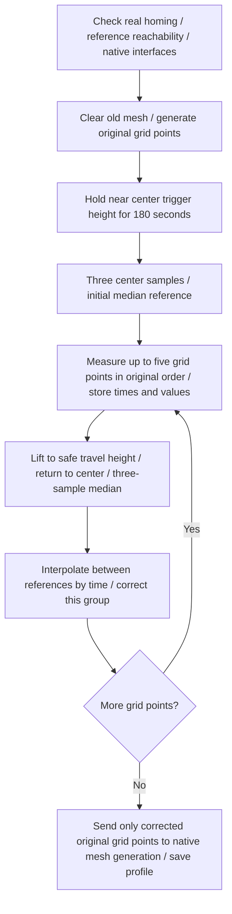

[简体中文](adaptive-mesh-drift.md) | **English**

# Center-Reference Drift Correction for Adaptive Mesh

This module repeatedly measures a fixed bed reference to estimate common drift during scanning, then corrects PA11 grid heights by time interpolation. The reference printer passed fixed-XY experiments and real-XY mesh integration checks. Adapt other printers using the [agent implementation steps](../skills/neptune4max-mods/references/adaptive-mesh-drift.md). “Thermal drift correction” does not mean all sensor and mechanical thermal errors have been separated and eliminated.

## Commands

In the complete reference configuration, `ADAPTIVE_BED_MESH` automatically calls the new module; the existing Bambu Studio start code needs no extra correction command. Bounds parsing, PA-file recognition, point counts, interpolation selection, and ADXL contact coverage retain their previous rules.

| Command | Behavior |
|---|---|
| `ADAPTIVE_BED_MESH ... PROFILE=adaptive` | Original adaptive-area scan with center-reference time interpolation correction |
| `ADAPTIVE_BED_MESH ... PLAN_ONLY=1` | Plan only; no hold, motion, or probing |
| `BED_MESH_CALIBRATE` / original `G29` | Original behavior; this correction is not enabled automatically |
| `ADAPTIVE_MESH_DRIFT_CALIBRATE PROFILE=default` | Scan the original full `[bed_mesh]` bounds and point counts with the same correction |
| `ADAPTIVE_MESH_DRIFT_STATUS` | Report module and last-scan state without movement |

New scan commands do not automatically heat, home, or align dual Z. The caller must finish preparation. After power-on or Klipper restart, perform real XYZ homing rather than trust assigned factory coordinates. The module tracks XYZ through physically completed homing rails and requires rehoming after all motors are released. Assigning `SET_KINEMATIC_POSITION` cannot bypass this check.

For full-bed reference correction only, use the new full-bed command after establishing safe homing, temperature, and mechanical conditions. It requires neither ADXL contact detection nor MCU flashing. The existing adaptive macro's bounds resolver is still registered by the ADXL module; a mesh-only setup needs separate adaptation of that registration.

## Scan sequence



Conditioning first makes one non-contact PA11 trigger measurement, then waits at that height for 180 seconds using the host monotonic clock. Afterward it lifts and probes three times, taking the median as the initial reference. This sensor preparation stage **does not replace the original 300-second bed stabilization**.

An additional center measurement follows every five **grid positions**, not every five individual triggers. Grid sampling still follows original `[probe]` settings—three samples with median on the reference printer—while reference measurements always use three samples with median. The final group receives a reference even if shorter than five points, bracketing every point. N grid positions need `ceil(N/5)` additional references, plus the initial three-sample reference and single conditioning-position trigger.

Travel to the center uses original mesh `horizontal_move_z` and safe travel limits. A reference outside the adaptive region may be measured separately if it remains inside the full probeable bed and reachable nozzle area. It does not enlarge the matrix or become another model grid point.

## Time interpolation and coordinates

Let initial reference median be B, surrounding references be `(t0,R0)` and `(t1,R1)`, grid raw height be `Zraw(i)`, and its measurement time be `ti`:

```text
D(ti) = (R0 - B) + (ti - t0) / (t1 - t0) * (R1 - R0)
Zcorrected(i) = Zraw(i) - D(ti)
```

Times come from the same Klipper print-time clock at native measurement completion, not web polling arrival times. Explicit floating-point division avoids Python 2 integer truncation. It interpolates only between adjacent references, without extrapolation, fitting drift from grid shape, or deleting high-deviation grid points.

Correction retains original XY and subtracts only estimated common Z drift. Current native `BedMeshCalibrate.probe_finalize` then preserves serpentine ordering, mesh interpolation, probe Z offset, and profile behavior. This module does not rewrite global `SET_GCODE_OFFSET`; subsequent ADXL uses the generated adaptive profile. As with native mesh, profile saving updates in-memory configuration without automatically invoking `SAVE_CONFIG`.

`reference_position` is the **probe's position on the bed**. The reference is `(215,215)` with probe XY offset `(-24.25,+20.45)`, so nozzle position is `(239.25,194.55)`. Do not copy the macro's ADXL coverage `variable_reference_x/y` nozzle coordinates directly into this setting. Use the target bed center, actual offsets, and safe limits: nozzle position = reference probe position − probe offset.

## Files, parameters, and compatibility

- Module: [adaptive_mesh_drift.py](../source/klipper/klippy/extras/adaptive_mesh_drift.py), installed in target Klipper `klippy/extras/`.
- Configuration: [adaptive_bed_mesh.cfg](../config/reference/adaptive_bed_mesh.cfg); merge the new section and internal builder's scan command rather than replace the whole main configuration.
- Agent handoff: [deployment, acceptance, and rollback](../skills/neptune4max-mods/references/adaptive-mesh-drift.md).

```ini
[adaptive_mesh_drift]
reference_position: 215.0, 215.0
reference_interval: 5
condition_seconds: 180
max_reference_drift: 0.500
max_reference_jump: 0.080
```

The last two parameters limit total reference change from the baseline and change between adjacent references, in mm. They are fault-check values used on this printer, not a claim that valid thermal drift is always smaller. Exceeding a limit raises an error and clears the current active mesh. Do not repeatedly relax limits to conceal probe or mechanical faults. Supported configuration ranges are 1–20 points per interval and 0–600 seconds conditioning; the deployment uses the verified five points/180 seconds.

The implementation supports this printer's Python 2.7.16 / Klipper `v0.10.0-530-g3387a9c2-dirty` without upgrading the interpreter, modifying native `bed_mesh.py` or `probe.py`, or changing Linux MCU code. It calls old internal mesh/probe interfaces and **is not universal across all Klipper versions**. Compare interfaces first. Current support is rectangular automatic meshes without `faulty_regions`; manual probing is unsupported, and incompatible configurations fail explicitly.

## Status, validation, and limits

`ADAPTIVE_MESH_DRIFT_STATUS` reports phase, real homing state, point/reference counts, and the last result. API object `adaptive_mesh_drift.last_run` retains raw points/times, independent references/times, corrected points, and validity. Successful records also enter the Klipper log. Phases include conditioning, mesh, reference, complete, and failed. After a long-request timeout, inspect these states rather than blindly resubmit a scan.

The [validation record](validation/adaptive-mesh-drift-20261013.en.md) separates fixed-XY algorithm experiments, offline compatibility tests, and an actual 4×4 scan. Reference change can include bed or gantry movement. One reference may not represent the entire bed, and local sensor temperatures or nonlinear changes between references can leave residual error. Validate repeatability and first-layer printing on the target; these results are not a precision guarantee for every printer.

On failure, do not produce a successful mesh, continue dependent ADXL/printing, or automatically lower Z or force a lift. Save status and the first error. Restore the old builder and added section according to target backups, reload, and native scanning is available again. Detailed backup mapping and recovery are in the agent implementation guide.
