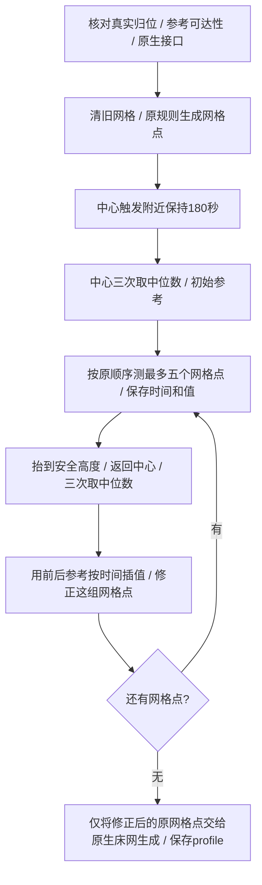

# 自适应床网的中心参考温漂修正

本模块用固定床面参考点的重复测量，估计扫描期间的公共漂移，再按时间插值修正 PA11 网格高度。参考机已完成固定 XY 实验及实际 XY 网格集成验证；其他机器需按[智能体实施步骤](../skills/neptune4max-mods/references/adaptive-mesh-drift.md)适配。这里的“温漂补偿”不代表已经分离并消除了所有传感器和机械热误差。

## 运行入口

完整参考配置中的 `ADAPTIVE_BED_MESH` 自动调用新模块，Bambu Studio 的原开始代码无需另加补偿命令。范围解析、PA 文件识别、点数、插值算法和 ADXL 接触覆盖区域保持原来的规则。

| 命令 | 行为 |
| --- | --- |
| `ADAPTIVE_BED_MESH ... PROFILE=adaptive` | 原自适应区域扫描，加中心参考时间插值修正 |
| `ADAPTIVE_BED_MESH ... PLAN_ONLY=1` | 仅输出计划；没有等待、运动或探测 |
| `BED_MESH_CALIBRATE` / 原 `G29` | 保持原流程，不自动启用这项修正 |
| `ADAPTIVE_MESH_DRIFT_CALIBRATE PROFILE=default` | 按 `[bed_mesh]` 原完整范围和点数扫描，并使用同样的修正 |
| `ADAPTIVE_MESH_DRIFT_STATUS` | 无运动，报告模块和上次扫描状态 |

新扫描命令不自动加热、归位或双 Z 调整。调用者先完成对应准备；每次上电或重启 Klipper 后必须真实 XYZ 归位，不能把原厂写入的默认坐标当成 Home。新模块通过实际完成归位的 rails 跟踪 XYZ，全局释放电机后要求重新归位；只写 `SET_KINEMATIC_POSITION` 不能绕过检查。

仅要全床参考修正时，可以在安全归位条件已确认、温度和机械基准准备好后调用新的全床命令。它不依赖 ADXL 接触检测，也不需要刷写 MCU；现有自适应宏的范围 resolver 仍由 ADXL 模块注册，只选自适应床网时需另外适配这一注册入口。

## 扫描过程



近床保持先做一次 PA11 非接触触发，再在该高度等待180秒；实际等待按主机 monotonic 时钟计时。等待结束后重新抬升并探测三次，取中位数作为初始参考。它是新的传感器近床准备阶段，**不代替原开始流程中300秒热床稳定等待**。

每五个“网格点位”补一次中心测量，不是每五次单独的触发。网格采样仍遵循原 `[probe]` 参数，本机为三次中位数；参考测量固定三次中位数。最后不足五个点也补测，确保所有点都有前后参考。N个网格点有 `ceil(N/5)` 次追加参考，另有开始时的一组三次参考和用于保持定位的单次触发。

返回中心前使用原床网 `horizontal_move_z` 和安全行程；参考点即使在当前自适应区域外也可单独测量，但必须在完整可探测床面和喷嘴可达范围内。它不会扩大网格矩阵，也不是另一个模型探点。

## 时间插值与坐标

设初始参考中位数为 B，某一组前后参考为 `(t0,R0)`、`(t1,R1)`，网格点原始值为 `Zraw(i)`、时间为 `ti`：

```text
D(ti) = (R0 - B) + (ti - t0) / (t1 - t0) * (R1 - R0)
Zcorrected(i) = Zraw(i) - D(ti)
```

时间取自同一个 Klipper print-time 时钟，在原生测量返回时记录；不使用网页轮询到达时间。Python2中显式浮点除法，避免整数截断。只做相邻参考之间的插值，不外推、不用网格自身的起伏拟合漂移、不删除偏差较大的网格点。

修正保留原 XYZ 中的 XY，只扣除估计的公共 Z 漂移。然后调用当前版本原生 `BedMeshCalibrate.probe_finalize`，保留蛇形扫描排序、床网插值、探针 Z offset 和 profile 逻辑。全局 `SET_GCODE_OFFSET` 不由本模块改写；后续 ADXL 仍使用生成的 adaptive profile。与原床网一样，profile 保存更新内存配置，不主动执行 `SAVE_CONFIG`。

`reference_position` 是**传感器在热床上的坐标**。参考机为 `(215,215)`；探针 XY 偏移 `(-24.25,+20.45)`，所以喷嘴位置为 `(239.25,194.55)`。不要把宏中用于 ADXL 覆盖的 `variable_reference_x/y` 喷嘴坐标直接填入这个设置。目标机应使用自己的热床中心、实际偏移和安全范围，换算关系为“喷嘴位置 = 参考探针位置 − 探针偏移”。

## 文件、参数与兼容

- 新模块：[adaptive_mesh_drift.py](../source/klipper/klippy/extras/adaptive_mesh_drift.py)，安装到目标 Klipper 的 `klippy/extras/`。
- 配置：[adaptive_bed_mesh.cfg](../config/reference/adaptive_bed_mesh.cfg)，合并新增 section 与内部 builder 的扫描命令；不要整体覆盖主配置。
- 接手步骤：[部署、验收和回退](../skills/neptune4max-mods/references/adaptive-mesh-drift.md)。

```ini
[adaptive_mesh_drift]
reference_position: 215.0, 215.0
reference_interval: 5
condition_seconds: 180
max_reference_drift: 0.500
max_reference_jump: 0.080
```

后两个参数分别限制参考相对初值的累计变化、相邻参考的变化量，单位mm。它们是本机采用的故障检查值，不是宣称合理温漂必然小于该值。超限报错并清除本次活动网格；不能靠不断放宽限制掩盖探针或机械异常。配置支持间隔1～20点、保持0～600秒，实际部署使用已验证的5点/180秒。

实现兼容本机 Python2.7.16 / Klipper `v0.10.0-530-g3387a9c2-dirty`，不升级解释器，不修改原生 `bed_mesh.py` 或 `probe.py`，不改 Linux MCU。代码调用旧版内部床网和 probe 接口，**不是通用于所有新旧 Klipper 的插件**；其他版本先比对接口。当前支持矩形网格、无 `faulty_regions` 的配置，不支持手动测网；不兼容时明确退出。

## 状态、验证与边界

`ADAPTIVE_MESH_DRIFT_STATUS` 报告阶段、真实归位状态、点数、参考数和最后结果。API 对象 `adaptive_mesh_drift.last_run` 保留原始点/时间、独立参考/时间、修正点及有效标记；成功记录也写入 Klipper 日志。阶段包括 conditioning、mesh、reference、complete、failed。长请求超时先查这些状态，不盲目重发扫描。

[验证记录](validation/adaptive-mesh-drift-20261013.md)区分固定 XY 算法实验、离线兼容测试和实际4×4扫描。中心参考的变化也可能包含床面、龙门等机械变化；参考点不能保证代表整个床面，局部传感器温度差和参考之间的非线性变化仍可能留下误差。重复测量和首层打印验证应在目标机完成，不能把本机结果当成所有机器的精度承诺。

失败时不输出“成功”床网、不继续执行依赖该网格的 ADXL/打印，也不自动降低 Z 或强制回抬。先保存状态和首个错误；按目标配置恢复旧 builder 与新增 section、重新加载，原生扫描即可恢复。具体备份映射和恢复步骤见智能体实施文档。
