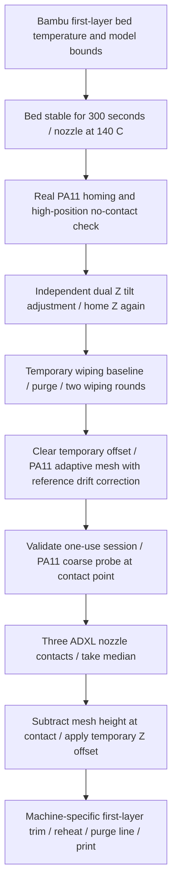

[简体中文](features.md) | **English**

# How the Features Work and Their Limits

## Preparation for one print



This sequence assumes the complete hardware setup. Reorganize it for selected features: without a wiper, do not retain the full wiping path or fabricate AFTER_WIPE authorization.

## Bed stabilization and console messages

Start-code `ADXL_Z_OFFSET_PREPARE_WIPE ... SOAK=300` sets the first-layer bed temperature and a 140°C nozzle target, then waits for stabilization. **The 300-second timer starts when measured bed temperature enters target ±1°C**, not when heating is requested. Any observed excursion resets it. Completion also requires measured nozzle temperature within 140±2°C.

The console reports about every 30 seconds, for example:

```text
ADXL bed heat soak: bed=69.6/70.0C stable=120/300s
```

Here the bed reads 69.6°C against a 70°C target and has been stable for 120 of the required 300 seconds. If it stays within range, about 180 seconds remain. Even after the bed requirement is met, it continues waiting if the nozzle is not within its required range. `ADXL bed heat soak complete` marks completion. Changing either target during the process causes an error and exits.

This gives the large bed and structure time to continue stabilizing, reducing calibration during ongoing heating and deformation. It relies on the bed temperature sensor, does not measure temperature uniformity across the plate, and does not prove every location has reached full thermal equilibrium.

After cleaning, `ADXL_Z_OFFSET ... SOAK=0 AFTER_WIPE=1` consumes the previously created one-use session for the same file and bed temperature instead of repeating 300 seconds. Temperature checks still apply. See [adxl345_z_offset.py](../source/klipper/klippy/extras/adxl345_z_offset.py) for the implementation and [start code](../slicer/start_gcode.txt) for slicer calls.

## Z_TILT, bed mesh, and ADXL

`Z_TILT_ADJUST` moves the two Z motors relative to each other to align the gantry. Each PA11 point currently uses three samples and their median; Klipper fits a plane to the six points and calculates corrections from the leadscrew positions. It does not simply subtract separate left and right three-point averages. `retry_tolerance: 0.02` checks the range of point heights, with up to five retries. Local bed unevenness may prevent convergence; this tolerance does not guarantee a physical left/right height error below 0.02 mm.

The reference setting `speed: 350` (mm/s) controls XY travel between tilt-calibration points to shorten calibration, without changing the probe's Z probing speed. On 2026-10-15, the owner confirmed that the `0.02` tolerance and `350` speed had been validated on this printer. This publication uses those owner-provided values without reconnecting to or retesting the printer. Recipients must check the target machine's velocity and acceleration limits and convergence before adopting them. See the [dual Z reference configuration](../config/reference/independent_dual_z.cfg).

`BED_MESH_CALIBRATE` measures bed shape using PA11. Z moves up and down during probing, but this command does not perform independent dual Z tilt correction. During printing, the mesh adds position compensation to common Z motion.

`ADXL_Z_OFFSET` establishes the overall nozzle contact Z reference using `median_tap_z - mesh_z_at_contact + contact_trim`. It applies it through `SET_GCODE_OFFSET ... MOVE=0`, without accumulating an old offset or invoking SAVE_CONFIG. Slicer `Z_ADJUST=0.140` is the owner's additional trim for the reference printer.

Ordinary `G28` does not automatically adjust tilt. In the complete reference configuration, `DUAL_Z_LEVEL` runs G28 → Z_TILT → G28 Z; `G29` calls it before mesh measurement; and the `ADXL_Z_OFFSET_PREPARE_WIPE` wrapper calls it after preparation. The supplied start code therefore aligns the gantry before wiping and the new mesh. Do not add Z_TILT calls that disrupt this order.

## ADXL contact detection

The factory toolhead's `adxl345 x` connects through Linux MCU SPI `spidev0.0`. With `axes_map: x,z,-y`, machine Z corresponds to chip raw Y Single Tap. Custom C code polls status at 2 kHz in the Linux MCU and uses `trsync_do_trigger` to stop Z stepping across MCUs. Python organizes measurements. No additional INT wire is used.

This path has cross-MCU latency; stopping is not instantaneous. Its recipe, travel, and contact window were established for the reference machine. Reproduction needs a high-position no-contact check, PA11 reference, and controlled contact validation.

The current code constrains the recipe to 25 mm/s, 300 mm/s², 1.75g, 20ms DUR, 2kHz polling, and 120ms delay. After a PA11 coarse probe at the same point, each tap starts at coarse+5 mm. Three taps share that point; use their median, with a maximum range of 0.050mm and up to three groups. A definite no-trigger result discards the entire group and, after safe recovery, repeats coarse positioning. Communication errors, invalid contact windows, or failed retraction do not trigger blind retries. Hard probing floor -3.5, valid contact offset 1.50–2.80, manual baseline -2, and related limits need checks on the target printer.

The preparation session binds the current file, bed temperature, and print state. The reference uses one attempt and a 1800-second expiry. Final `AFTER_WIPE=1` requires the same BED_TEMP and SOAK=0; failure also consumes the session.

## Random contact points and local wear

Final `ADXL_Z_OFFSET` with `FUZZ=3` randomly offsets X and Y independently within ±3 mm of the configured contact center, selecting in 0.01 mm increments. This is an approximately 6×6 mm square, not a circle of radius 3 mm, and not three separately randomized tap points.

**One calibration selects one XY point. All three taps and up to three internal retry groups use it; the next calibration selects again.** Keeping one point makes the three heights comparable without mixing spatial bed differences into sample range. `ADXL contact fuzz: ... selected=...` reports the selected point.

The aim is to spread repeated nozzle contact near the center rather than concentrate wear at one location. Random selection can repeat and guarantees neither unique locations nor uniform coverage. No coating-life improvement has been quantified. Nozzle cleanliness, controlled stopping, and contact conditions still need validation.

The high-position no-contact check stays at the fixed center; PA11 adaptive mesh uses deterministic grid points. The new mesh must cover every possible contact location plus the 0.25 mm quantization allowance. Offset calculation uses mesh height at **the actual contact XY**, not always the center, to avoid interpreting local bed shape as an overall Z offset.

## Adaptive mesh

PA11 bounds and grid points are not randomized. Expand the first-layer bounding box by 10mm, union it with the ADXL center ±3mm contact area and 0.25mm quantization allowance, then limit it to the measurable area. Grid counts vary from 3 to 15, with lagrange for smaller grids and bicubic for larger grids. Invalid bounds fall back to a safe full-bed 6×6 mesh.

PA calibration files use actual positive-extrusion line segments only within explicit `PA_LINE_CALIBRATION_START/END` sections; ordinary models use slicer variables. `ADAPTIVE_MESH_RESOLVE` is registered by `adxl345_z_offset.py`, so copying adaptive cfg alone leaves a missing command. For mesh-only use, an agent must separate registration into an independent module and validate it rather than assume it is already independent.

Adaptive scanning now adds fixed-center reference correction using time interpolation: a 180-second near-bed hold, an initial three-sample median baseline, a center measurement every five points, and one after the final partial group. Corrected points go to native mesh generation; global Z offset is unchanged. This hold is separate from the earlier 300-second bed stabilization. Native `BED_MESH_CALIBRATE` / G29 retain their original behavior; corrected full-bed scanning uses a separate command. See [center-reference drift correction](adaptive-mesh-drift.en.md) for the algorithm, coordinates, commands, and limits, and [agent steps](../skills/neptune4max-mods/references/adaptive-mesh-drift.md) for deployment and acceptance.

## Fans, cold pulls, and layer information

Main PB7 `[fan] max_power: 0.70` scales output proportionally rather than clipping every 70–100% input to the same output. A 100% request means 70% PWM, not a guaranteed 70% RPM. PC9 auxiliary cooling does not use this limit. M106 without P, or with P0/P1, controls the main fan; P2 controls auxiliary. M107 without P stops both; P2 stops only auxiliary.

FAN4/PA8 uses `[controller_fan driver_cooling]` to monitor five drivers: X, Y, original Z, E1, and extruder. Any enabled motor causes 100% PWM; after all are released, it keeps full speed for about 60 seconds before stopping. It monitors **energized/holding state**: a stationary but locked motor still needs driver cooling. The supplied end code releases only X/Y/E and keeps Z locked, so the driver fan keeps running. `M107` does not turn this automatic channel off.

An empty `heater:` makes FAN4 follow motors only, without heating alone starting it. The matching minimal compatibility fix handles old Klipper's empty-list behavior; see [driver fan compatibility](software.en.md#driver-cooling-compatibility-with-old-klipper). PC7 hotend cooling is retained. FAN4 outputs 100% on abnormal MCU shutdown.

The owner's cold-pull recipe is G28 → Z200 → 250°C → extrude 150mm at 3mm/s → auxiliary 100%, nozzle target 110°C → switch auxiliary off at 110°C → target 90°C → retract 30mm at 1mm/s at 90°C → disable only the extruder motor → hold 90°C → two 100ms beeps. The owner selected 50% PWM by listening; this is not calibrated loudness. Material suitability and low-temperature retraction safeguards need separate checks on another printer.

Moonraker gains parsing for Bambu total layers, first-layer height, model height, and related metadata. Current-layer estimation in the old Fluidd version may be affected by Z-hop or variable layer height. `SET_PRINT_STATS_INFO` was not added, and precise per-layer counting across all interfaces is not promised.

Factory pause/resume, filament detection, lighting, resonance measurement, and PLR are retained, not claimed as original project features. Power-loss recovery with this combination of offset, mesh, and dual Z has not been specifically accepted.
