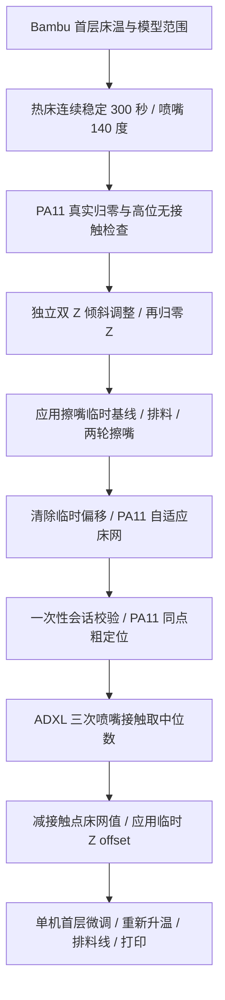

# 工作原理与功能边界

## 一次打印的准备顺序



顺序对应完整硬件组合。不同功能选择应重新组织流程，例如没有擦嘴条时不能保留完整擦嘴路径，也不能伪造 AFTER_WIPE 授权。

## 热床稳定等待与控制台日志

开始代码中的 `ADXL_Z_OFFSET_PREPARE_WIPE ... SOAK=300` 先设置本次首层床温和喷嘴 140°C，再等待热稳定。**300 秒从实测床温进入目标值 ±1°C 时开始计时**，不是从发出加热指令起等待五分钟；任何一次检测到超出范围都会清零重计。完成时还要求喷嘴实测温度处于 140±2°C。

控制台约每 30 秒报告一次，例如：

```text
ADXL bed heat soak: bed=69.6/70.0C stable=120/300s
```

这里热床实测 69.6°C、目标 70°C，已经连续稳定 120 秒，要求 300 秒；`120` 是已稳定时间。若后续一直保持范围内，床温稳定计时还需约 180 秒。床温已满足时，喷嘴尚未达到上述温度也会继续等待。出现 `ADXL bed heat soak complete` 才表示这一步完成；中途修改热床或喷嘴目标会使流程报错退出。

这样做是给大热床及其结构留出继续热稳定的时间，减少在持续升温和形变过程中校准。它以热床温度传感器为判断依据，不测量整块床面的温度均匀性，也不证明所有位置已经完全热平衡。

擦净喷嘴后，`ADXL_Z_OFFSET ... SOAK=0 AFTER_WIPE=1` 使用此前产生的同文件、同床温一次性会话，不再重复等待 300 秒；仍检查床温和喷嘴温度条件。完整参考流程的等待逻辑见 [adxl345_z_offset.py](../source/klipper/klippy/extras/adxl345_z_offset.py)，切片调用见[开始代码](../slicer/start_gcode.txt)。

## Z_TILT、床网与 ADXL 的区别

`Z_TILT_ADJUST` 会让两个 Z 电机相对运动，用于调整龙门左右姿态。当前每个探点 PA11 三次采样取中位数，随后 Klipper 对六点拟合平面并按两根丝杆的位置计算修正；不是分别算左右三点平均后机械相减。`retry_tolerance: 0.03` 对探点高度范围作收敛判断，最多重试五次，床面局部不平可能使其不收敛。

`BED_MESH_CALIBRATE` 用 PA11 获取床面形状，探测时 Z 会升降，但不执行独立双 Z 倾斜校正。打印阶段床网给共同 Z 运动增加位置补偿。

`ADXL_Z_OFFSET` 获取喷嘴接触面的整体 Z 基准，计算 `median_tap_z - mesh_z_at_contact + contact_trim`，通过 `SET_GCODE_OFFSET ... MOVE=0` 应用，不叠加旧 offset，也不 SAVE_CONFIG。切片中的 `Z_ADJUST=0.140` 是参考机主另加的单机微调。

普通 `G28` 不会自动调用倾斜调整。完整参考配置中：`DUAL_Z_LEVEL` 执行 G28 → Z_TILT → G28 Z；`G29` 在床网前调用它；`ADXL_Z_OFFSET_PREPARE_WIPE` 包装宏在准备结束后调用它。因此使用所给开始代码时会在擦嘴与新床网前调整，不能再随意插入改变次序的 Z_TILT。

## ADXL 接触检测

原厂工具头 `adxl345 x` 经 Linux MCU SPI `spidev0.0` 接入。`axes_map: x,z,-y` 对应机器 Z 使用芯片 raw Y 的 Single Tap。定制 C 代码在 Linux MCU 中以 2 kHz 读取状态，通过 `trsync_do_trigger` 停止跨 MCU 的 Z 步进，Python 负责测量组织。没有新增 INT 飞线。

这条路径存在跨 MCU 延迟，不是零延迟停步。参数配方、行程和接触窗口针对本机形成，首次复刻需要高位无接触检查、PA11 参考和受控接触验证。

现有代码约束配方为 25 mm/s、300 mm/s²、1.75g、20ms DUR、2kHz、120ms 延迟。PA11 同点 coarse 后，每次 Tap 从 coarse+5 mm 起步，三次同点，中位数，极差不超过 0.050mm，最多三组。明确无触发时丢弃整组并在安全恢复后重新粗定位；通信错误、无效接触窗口、回抬失败等不盲目重试。探测硬下限 -3.5、有效 contact offset 1.50～2.80、manual baseline -2 等都需目标机器核对。

准备会话绑定当前文件、床温和打印状态，参考配置中单次使用、1800 秒超时，正式测量 `AFTER_WIPE=1` 要求相同 BED_TEMP 和 SOAK=0；失败同样消耗会话。

## 随机接触点与局部磨损

正式 `ADXL_Z_OFFSET` 的 `FUZZ=3` 让 X、Y 分别在配置接触中心的 ±3 mm 内随机偏移，以 0.01 mm 为步距选点。这是约 6×6 mm 的方形区域，不是半径 3 mm 的圆，也不是“三次各随机一个点”。

**一次校准只选一个 XY 点，三次 Tap 及最多三组内部重试都沿用该点；下一次校准再重新选择。** 保持同点有利于比较三次接触高度，避免把床面不同位置的高度差混入样本极差。控制台 `ADXL contact fuzz: ... selected=...` 会报告本次选中的位置。

其目的是把长期重复的喷嘴接触分散到中心附近，减少磨损集中在单个位置。随机选点可能重复，不保证每次位置不同或均匀遍历；也没有测得涂层寿命的改善幅度。喷嘴清洁、受控停止和接触条件仍需验证。

高位无接触检查保持固定中心，PA11 自适应床网使用确定的网格探点。新床网必须覆盖整个可能接触区域及 0.25 mm 量化余量。计算 offset 时取**本次实际接触 XY** 的床网高度，而不是始终取中心高度，避免把床面局部起伏当成整体 Z 偏移。

## 自适应床网

PA11 范围与探点不随机。按首层包围框外扩 10mm，并与 ADXL 中心±3mm加 0.25mm 量化余量的区域取并集，再限制到可测范围。动态 3～15 点，较小网格用 lagrange，较大用 bicubic；无有效范围回退安全全床 6×6。

PA 校准文件只有明确 `PA_LINE_CALIBRATION_START/END` 段才从实际正向挤出线段解析范围；普通模型继续使用切片变量。`ADAPTIVE_MESH_RESOLVE` 由 `adxl345_z_offset.py` 注册，单独复制 adaptive cfg 会缺命令。若只要床网，AI 需拆出独立注册模块并验证，而不是假设它已经独立。

## 风扇、冷拔与层数

主 PB7 `[fan] max_power: 0.70` 用比例映射，不把 70～100% 输入统一截成同一值。100% 输入是 70% PWM，不是保证 70% RPM。PC9 辅助通道不受该上限约束；M106 默认/P0/P1 为主，P2 为辅助；M107 无 P 关闭两者，P2 只关辅助。

FAN4/PA8 使用 `[controller_fan driver_cooling]`，监控 X、Y、原 Z、E1 和挤出机五个步进驱动。任一电机使能时输出 100% PWM，全部释放后保持全速约 60 秒再关闭。这里监控的是**电机通电/保持状态**；电机不转但仍锁定时，驱动仍需散热。所给结束代码只释放 X/Y/E，Z 继续锁定，因此驱动风扇也继续运行。`M107` 不关闭这个自动散热通道。

`heater:` 留空使 FAN4 只跟随电机，不由单独加热触发。旧 Klipper 空列表兼容问题由配套的最小源码修正处理，详见[驱动风扇适配](software.md#驱动专用散热风扇的旧版兼容)。PC7 的热端散热控制保留，异常 MCU shutdown 时 FAN4 输出 100%。

冷拔按参考机主选择的配方：G28 → Z200 → 250°C → 挤出150mm/3mm每秒 → 辅助100%、目标110°C → 降到110时关辅助 → 目标90°C → 降到90时回抽30mm/1mm每秒 → 仅关闭挤出机电机 → 保持90°C → 两声100ms提示。50% PWM 是机主试听选择，并不等于校准后的音量。材料配方和低温回抽保护须另机确认。

Moonraker 补充 Bambu 总层数/首层高度/模型高度等解析。当前旧版 Fluidd 的当前层估算可能受 Z-hop、变层高影响；未增加 `SET_PRINT_STATS_INFO`，也不能承诺各 UI 都显示精准逐层计数。

原厂的暂停续打、断料、灯光、共振测量及 PLR 功能只是保留，不算本项目原创。断电恢复对本项目 offset、床网和双 Z 的组合还未专门验收。
