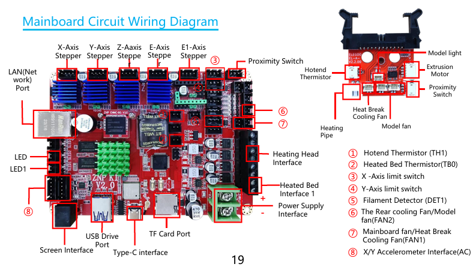
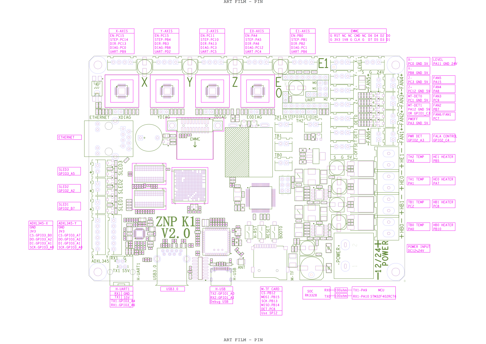

[简体中文](hardware.md) | **English**

# Hardware and Independent Dual Z

Before buying parts or disassembling the printer, read the [parts list and assembly steps](bom-and-assembly.en.md). This guide covers driver parameters, pins, reference geometry, and photos for adaptation and calibration.

## Verified combination

Neptune 4 Max, ZNP K1 V2.0, and MKS TMC2209 V2.0. When the two large sense resistors are marked R110, each is **0.110 ohm**, not 110 ohms, and they must not be added together as 0.220 ohm. They sense the two motor phase currents separately.

The reference E1 uses the UART jumper with M0/M1/M2 open and address 0. Existing `run_current: 0.6` and `stealthchop_threshold: 0` settings are retained. The 0.6 A value is the reference RMS motor current, not the driver's rated capability or a recommendation for every motor. Check the actual module revision, resistor markings, and insertion direction; the chip name alone is insufficient.

The E1 jumper photo shows **only UART bridged, with M0/M1/M2 empty**. The driver was removed to expose the jumpers; install the MKS TMC2209 V2.0 correctly to complete assembly.

| Board location | STEP | DIR | ENABLE | UART | Reference role |
|---|---|---|---|---|---|
| Original Z | PC10 | PA13 | PC11 | PC5 | `stepper_z` |
| Added E1 | PB1 | PB2 | PB0 | PB6 | `stepper_z1` |
| E0 | PA5 | PA6 | PA4 | PC4 | Original extruder; retained |
| FAN2 | PB7 | — | — | — | Main part-cooling fan |
| FAN3 | PC9 | — | — | — | Independent auxiliary part-cooling fan |
| FAN4 | PA8 | — | — | — | Dedicated driver cooling fan |
| FAN1 / FAN6 | PC7 | — | — | — | Shared output; only the hotend heatsink fan remains on it after modification |

These are physical pins without inversion prefixes. The reference configuration uses `dir_pin: PA13` for original Z and `dir_pin: !PB2` for E1, making observed positive motion raise both sides. Set inversion on the target printer from physical observations.

## Assembly

Remove the Z synchronization belt and both timing pulleys at the tops of the leadscrews so each side can move independently. Separate the parallel motor wiring and terminate it at original Z and E1. Preserve each motor's two coil pairs and check crimping and contact; do not infer phase order from wire colors. Install or remove drivers, jumpers, and motor connectors with power off. The driver needs a heatsink and board airflow.

Reuse the Neptune 4 Max's factory auxiliary fan, with no additional fan purchase, and connect it independently to FAN3. Match voltage and polarity; prepare wiring materials only if cable length or connectors do not fit. Sharing PB7 with the main fan cannot provide independent `P2` speed control.

Move the driver cooling fan from FAN6/PC7 to **FAN4/PA8**. FAN1 and FAN6 share PC7; separating driver cooling removes its dependency on hotend temperature. Keep FAN1 hotend cooling, check that no other configuration uses PA8, then merge [driver_cooling.cfg](../config/reference/driver_cooling.cfg). Power off before changing fan, motor, or module wiring.

Use a **silicone nozzle wiper compatible with the Bambu Lab A1**, installed on the **plastic bracket at the end of the bed cable connection**, as shown below. It is an accessible replacement part, but a photo is not coordinate calibration. Measure the target printer's contact position, height, toolhead clearance, and travel before generating its wiping path.

## Motor sides and automatic leveling coordinates

Define left and right while facing the printer from the front. The owner confirms that on the reference printer **original Z controls the left side and E1 controls the right**. Other printers may be wired differently. **Physically verify motor sides:** have the person beside the printer observe controlled small, slow movements of each channel and record the actual side and whether positive motion raises it. Do not assume the reference mapping applies.

These checks follow the [real homing rule](validation.en.md#homing-after-power-on-or-restart): establish safe homing conditions and complete real G28 before subsequent XYZ movements. If new wiring direction or clearance is uncertain, resolve it with the user; do not trust startup coordinates or attempt blind homing.

The first `z_positions` entry belongs to `stepper_z`, and the second to `stepper_z1`, as defined by the [Klipper configuration reference](https://www.klipper3d.org/Config_Reference.html#z_tilt). Verify positive upward motion and actual sides before Z_TILT; reversing the order makes correction act in the wrong direction.

The measured leadscrew center distance on the reference printer is 480 mm. Absolute X origin was not measured: historical reference positions -25 and 455 were estimated by centering on a 430 mm bed. They are not production drawing dimensions.

| Observed mapping | First `z_positions` entry | Second entry |
|---|---|---|
| Original Z left, E1 right | `-25, 215` | `455, 215` |
| Original Z right, E1 left | `455, 215` | `-25, 215` |

This table illustrates ordering only; measure the values on the target printer. Regression tests do not replace wiring and coordinate validation.

The six leveling points are **nozzle coordinates**: left X70, right X400, with Y184.55/194.55/204.55, in serpentine order. Reference PA11 probe positions are X45.75/375.75 and Y205/215/225 because offsets are X-24.25/Y+20.45. Each side's three points lie near the middle within about 20 mm, avoiding a large front-to-rear span.

## Troubleshooting entry point

For UART failure, check installation with power off, insertion direction, whether the driver is actually installed, module/resistor identity, UART and M0/M1/M2 jumpers, PB6, address 0, and power. Use `DUMP_TMC STEPPER=stepper_z1` to check communication. **Successful communication does not prove correct coil order, motor side, or direction.** Do not repeatedly home or adjust tilt without resolving these checks.

Manufacturer source: [official MKS TMC2209 hardware documentation](https://github.com/makerbase-mks/MKS-StepStick-Driver/tree/master/MKS%20TMC2209). This describes the module; the ZNP K1 jumper combination comes from the owner's tested setup and is not universal across boards.

## Wiring and pin diagrams

Factory board wiring diagram for motor, probe, heater, and fan connectors:

ZNP K1 V2.0 pin layout for E1 PB6 UART, FAN4 PA8, and shared FAN1/FAN6 PC7. The original attachment was called a schematic, but the image shows connector and pin layout:

