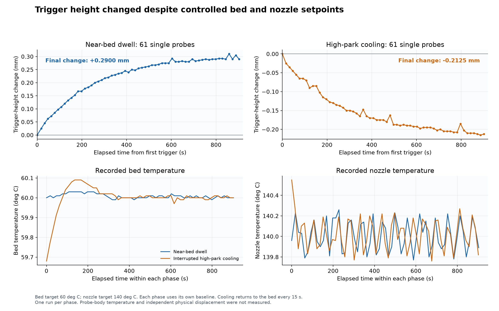
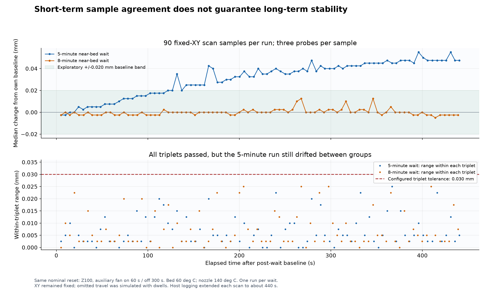
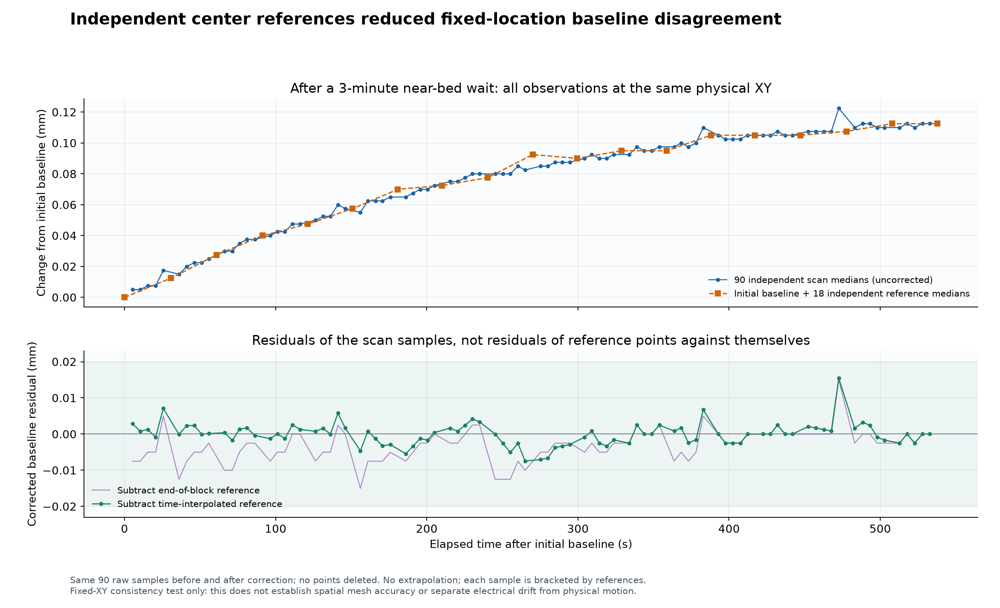
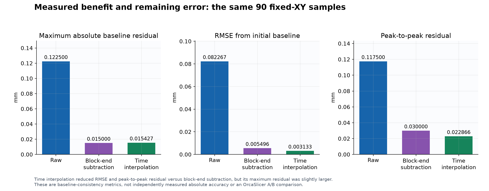
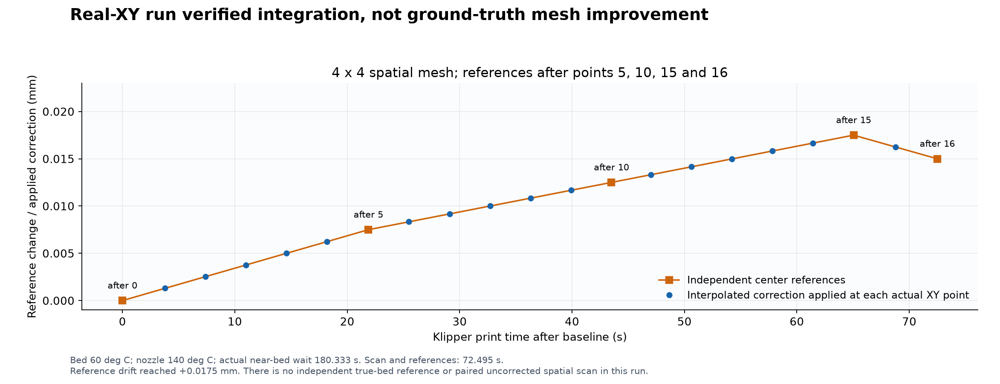

[简体中文](REPORT.md) | **English**

# Neptune 4 Max probe-system drift: observations, correction and limitations

Experiments: 13 October 2026. Reanalysis: 15 October 2026. These are engineering observations from **one reference printer**, not sensor certification or evidence about every Neptune 4. No new printer experiment was performed for this report.

## Main finding

On this machine, reaching and holding the bed thermistor target did not ensure a constant probe-trigger height over the following minutes. Agreement within a three-probe sample group also did not ensure agreement between groups several minutes apart. Independent periodic references reduced disagreement with an initial baseline in a fixed-location experiment.

The records do **not** isolate electrical drift inside the sensor. Probe-body temperature and independent physical displacement were not measured. Changes in the bed, mount, gantry, sensor and motion system can all contribute. The spatial representativeness of one reference point remains an open question.

## Equipment and shared conditions

- One Neptune 4 Max running the retained factory Klipper branch, recorded as `v0.10.0-530-g3387a9c2-dirty`, with Python 2.7.16. PA11 identifies its probe input pin, not a verified sensor model.
- Bed target 60°C, nozzle target 140°C. Main and auxiliary part-cooling fans were off during near-bed measurements. Hotend and driver fans retained their automatic behavior.
- Fixed-location probe coordinate: bed `(215,215)`. Probe offsets X=-24.25, Y=+20.45 give nozzle coordinate `(239.25,194.55)`.
- Real homing established the coordinate reference. It was preserved through the continuous measurements; homing or releasing the steppers was not used to redefine the baseline between samples. Active mesh and temporary G-code offset were cleared for testing and restored afterward. Offset was not changed between individual probe measurements.
- Warming/cooling runs used one probe per observation. Conditioning and reference trials used three probes per observation, the median, 8 mm/s probing, 3 mm sample retraction, and the existing 0.030 mm tolerance/retry behavior.
- ADXL and nozzle contact were not used in these drift experiments. Their results cannot validate the separate ADXL contact workflow.

The [manifest](source-manifest.json) lists 12 byte-identical CSV copies and SHA256 hashes. The [offline analysis](reproduce.py) verifies these files, recomputes medians from raw probes, and checks interpolation and summary metrics. No valid observations were removed. Decimal precision enables arithmetic checking and is not a claim of equivalent physical accuracy.

## 1. Near-bed warming trajectory

After the bed remained within 60±1°C for 300 seconds and the nozzle approached 140°C, the existing workflow performed real homing, dual-Z adjustment and final Z homing. At bed center, the head parked at Z80 with the auxiliary fan on for 60 seconds and off for 240 seconds. It returned to Z3 and immediately took a single probe measurement as baseline.

With physical XY fixed, it then lifted 3 mm to release the probe and took another single measurement about every 15 seconds, remaining near the trigger position between observations. There were 61 observations over 903.276 seconds.

| Observation | Result |
|---|---:|
| First / final trigger Z | -0.0975 / +0.1925 mm |
| Final change from first observation | **+0.2900 mm** |
| Peak-to-peak trigger range | 0.3100 mm |
| Changes at approximately 63 / 123 / 303 seconds | +0.0725 / +0.1200 / +0.2175 mm |
| Recorded bed-temperature range | **59.99–60.03°C** |
| Recorded nozzle-temperature range | 139.77–140.26°C |

Preparation had been interrupted by a control timeout and a recorder's incorrect interpretation of the legacy empty-mesh marker. Preparation was repeated before formal sampling; interrupted attempts supplied no formal readings. Total prior heating was therefore longer than a fresh cold start followed by a single 300-second soak.

The observed height change cannot be dismissed merely because the bed thermistor was at its target. It is not a measurement of a 0.29 mm first-layer gap error and does not identify which component moved or drifted.

## 2. Interrupted high-park cooling trajectory

Bed/nozzle targets remained 60/140°C, with the same mechanical coordinate reference and no new homing or dual-Z adjustment. After each observation the head returned to Z80. Before the next observation it returned to Z3 and probed, approximately every 15 seconds. Both part-cooling fans remained off.

Over 61 readings and 901.722 seconds, trigger Z changed from +0.1725 to -0.0400 mm: **-0.2125 mm**, opposite to the near-bed trend. Recorded bed temperature was 59.68–60.09°C and nozzle temperature 139.76–140.55°C.

Heating had briefly been disabled during cleanup of the preceding run and targets were restored. The last warming trigger and first cooling trigger were separated by 32.314 seconds; trigger Z changed -0.0200 mm across that gap. Each phase uses its own initial baseline. The plots do not connect the phases across an invented zero-time transition.

This is **interrupted high-park cooling**, because observation requires periodic returns to the bed. It is not a pure 900-second uninterrupted cooling curve. Opposite trends under the two trajectories support a thermal-history-related explanation, without separating sensor behavior from mechanical effects. Historical exponential fits were descriptive; their parameters were not independently validated as a production correction model.



## 3–4. Five-minute versus eight-minute conditioning

Both trials used the same nominal reset: Z100, auxiliary fan on for 60 seconds and off for 300 seconds, at targets 60/140°C. The head returned to Z3, probed once, and remained near that initial trigger position for approximately 300 or 480 seconds. After lifting, a separate three-probe median established each run's post-wait baseline.

The then-current first-layer test footprint generated a virtual 9×10 grid. **Physical XY remained fixed at bed center.** Actual Z probing was retained; omitted XY travel was represented by estimated dwells. Each run acquired 90 scan medians from 270 individual scan probes, with no retries.

| Metric | 5-minute wait | 8-minute wait |
|---|---:|---:|
| Actual near-bed hold | 300.141 s | 480.391 s |
| Final scan time after baseline | 440.425 s | 439.073 s |
| Maximum absolute baseline difference | **0.0550 mm** | **0.0125 mm** |
| Range of the 90 scan medians | 0.0575 mm | 0.0175 mm |
| Final baseline difference | +0.0475 mm | -0.0025 mm |
| Largest accepted within-triplet range | 0.0250 mm | 0.0250 mm |
| Scan retry groups | 0 | 0 |

Longer conditioning is a credible simple alternative: the eight-minute run was substantially more stable. Each duration was tested once, with no independent probe-temperature measurement, so this does not establish a universal eight-minute requirement or guarantee.

All triplets passed the same 0.030 mm tolerance, while the five-minute run continued to change between groups. A local sampling acceptance condition therefore did not establish stability across the scan. Host communication, synchronization and logging extended the runs to about 440 seconds. Estimated XY dwells do not reproduce real scan duration, airflow or spatial temperature variations exactly.



## 5. Three-minute conditioning with an independent reference every five points

After the same nominal high-park reset, actual near-bed conditioning lasted 180.047 seconds. A separate three-probe median established baseline B=+0.0300 mm. The fixed-XY trial collected 90 scan samples and an additional independent reference median after every five samples: 18 extra reference groups.

Scan groups contributed 270 individual probes and extra references 54. Including the arrival probe and three-probe initial baseline, the raw record contains 328 probes. Scan and reference observations were separate acquisitions; neither used retries. The final scan sample occurred at 532.579 seconds and final reference at 537.832 seconds after baseline.

For reference `R_k`, its change is `D_k=R_k-B`. Including the initial `(time=0, change=0)` reference, each scan sample is bracketed by two independent references:

```text
D(t_i) = D_previous + (D_next - D_previous)
                       * (t_i - t_previous) / (t_next - t_previous)
Z_corrected(i) = Z_raw(i) - D(t_i)
baseline_residual(i) = Z_corrected(i) - B
```

There is no extrapolation. Drift was not fitted from the 90 scan samples. The evaluation uses **scan-sample residuals**, not references subtracted from themselves. A simpler end-of-block subtraction was retained as a comparison.

| Baseline-consistency metric | Raw | Block-end subtraction | Time interpolation |
|---|---:|---:|---:|
| Maximum absolute difference | **0.122500 mm** | 0.015000 mm | **0.015427 mm** |
| Peak-to-peak range | 0.117500 mm | 0.030000 mm | 0.022866 mm |
| RMSE | **0.082267 mm** | 0.005496 mm | **0.003133 mm** |
| 95th percentile of absolute difference | 0.112500 mm | 0.012500 mm | 0.006693 mm |

The observed reduction in maximum baseline difference was about 87.4%. Interpolation improved RMSE and range compared with block-end subtraction; its maximum residual was slightly larger. The largest residual was retained. These before/after metrics use exactly the same raw scan observations.

**This is evidence of improved consistency relative to an initial fixed-location baseline, not independently measured absolute spatial accuracy.** Samples share the sensor and mechanical system, reference noise propagates, and correlated errors were not isolated. Wait duration and measurement cadence also differ from the five/eight-minute trials, so a cross-run ranking would not be a controlled comparison.





## 6. Real-XY integration check

After deployment, real homing and the existing dual-Z routine were performed at 60/140°C with both part-cooling fans off. The normal adaptive entry point received model bounds X/Y180–220 and a 10 mm margin. It also reserved the area required for the later contact-calibration location, producing a real 4×4 spatial mesh.

Near-bed conditioning actually lasted 180.333 seconds. Initial reference Z was 0.1350 mm. References after points 5, 10, 15 and 16 changed by +0.0075, +0.0125, +0.0175 and +0.0150 mm. The final partial block also had a following reference. Scan and reference acquisition lasted 72.495 seconds, excluding preparation.

The historical audit checked interpolation, mapping of all 16 corrected samples into the native serpentine matrix, and profile integration. This reanalysis independently verifies the CSV interpolation and `raw - correction = corrected` arithmetic. **Successful real-XY integration does not establish a more accurate true-bed estimate.** There was no independent physical ground truth or paired uncorrected spatial scan.



## What the criticism gets right, and what the measurements address

**Bed temperature and thermal stability.** Bed thermistor readings do not measure probe-body temperature or eliminate later changes in the apparatus. The fixed-location observations address an absolute claim that target attainment alone excludes drift. They do not demonstrate a general defect in all modern inductive sensors, or establish that the sensor electronics caused all observed changes.

**Tolerance and retries.** `samples_tolerance` checks spread within a sample group. Larger values relax acceptance; smaller values tighten it. Neither directly estimates a minutes-long trend between groups. A separate longer-window stability check is a reasonable alternative and has not been compared head-to-head here. The eight-minute observation supports taking stabilization seriously.

**One reference versus the whole bed.** This is a valid limitation. In the simplified measurement model `m(x,y,t)=h(x,y)+c(t)+l(x,y,t)+e`, h is reference-time bed shape, c is common drift, l is location-dependent change and e is noise. Center-reference subtraction estimates c but also includes center-local changes and reference noise. If the center changes differently from the rest of the bed, subtraction can introduce error elsewhere. Common drift must dominate for spatial benefit; the fixed-XY experiment does not establish that condition across the bed.

**Reference samples and non-part areas.** Repeated center references are not inserted as extra spatial mesh nodes. Separately, the project's adaptive bounds reserve coverage for the later ADXL contact location, so that the mesh height can be evaluated there. That can expand the meshed rectangle and cost time; it is specific to this workflow, not a universal requirement for adaptive meshing.

**Offset calibration and ADXL.** A constant calibration value cannot by itself cancel an evolving trigger-height trend. The drift module edits sample Z values before native bed-mesh finalization; it does not issue `SET_GCODE_OFFSET`. The separate nozzle-contact/offset workflow needs its own validation, and these inductive-probe experiments do not settle that debate.

**Existing adaptive meshing.** This project has no controlled A/B evidence of superiority over OrcaSlicer's direct adaptive workflow with a well-conditioned probe. Choosing mesh bounds and assessing time-dependent trigger readings are distinct aspects of measurement. Extra references add acquisition and travel time; they are not a free improvement.

## Official documentation and scope of review

[Klipper's temperature-bias guidance](https://www.klipper3d.org/Probe_Calibrate.html#temperature-bias) advises consistent thermal conditions and waiting, and describes comparing cold/hot measurements without rehoming or releasing the steppers. These tests preserved a coordinate reference, but changed near/far-bed history at fixed heater targets rather than reproducing that official cold/hot test. Klipper does not thereby endorse this interpolation method.

The [probe configuration reference](https://www.klipper3d.org/Config_Reference.html#probe) describes sample aggregation and within-group tolerance/retries. This local behavior was also checked in the reference machine's saved legacy `probe.py`.

The [OrcaSlicer adaptive-mesh documentation](https://github.com/OrcaSlicer/OrcaSlicer/wiki/printer_basic_information_adaptive_bed_mesh) passes bounds, probe counts and interpolation settings to bed calibration. [Klipper adaptive meshing](https://www.klipper3d.org/Bed_Mesh.html#adaptive-meshes) describes object-area coverage and point scaling. Those features do not provide evidence that this machine's recorded time variation did not occur.

The cited Neptune4.help page could not be retrieved during this review. No claim is made to have verified its specific recommended values or rebutted its full contents. See [sources](sources.md).

The published [correction function](https://github.com/dadalangx/neptune4max-autoprep/blob/468c40c689b60bea7c9cf67f59210503890fcade/source/klipper/klippy/extras/adaptive_mesh_drift.py#L15-L34) preserves XY and subtracts the estimated change from Z. [Native finalization](https://github.com/dadalangx/neptune4max-autoprep/blob/468c40c689b60bea7c9cf67f59210503890fcade/source/klipper/klippy/extras/adaptive_mesh_drift.py#L256-L259) receives corrected mesh samples, excluding the extra references.

## Defensible conclusion and next validation

This printer showed substantial trigger-height changes associated with near/far-bed thermal history even while heater readings remained near target. Independent periodic references improved fixed-location baseline consistency; real-XY integration was verified. The evidence supports investigation, not a universal sensor-temperature coefficient or a proven advantage over a simpler well-conditioned workflow.

A stronger evaluation needs repeated, interleaved comparisons of conventional meshing after adequate stabilization, a longer-window stability gate, and shorter conditioning with periodic references. Hold hardware, plate, heater targets, geometry and sample settings constant. Use multiple reference locations and independent displacement measurements to separate local shape changes from common effects. Compare spatial errors, first-layer results, failures, retries and total preparation time, including poor runs. Those experiments have not been performed here.

## Reproduction

Use Python with [requirements.txt](requirements.txt), then run `python reproduce.py`. The script reads local CSV files, verifies their hashes and arithmetic, and generates `summary.json` and five English PNG/SVG figures. It has no printer, SSH or network interface. It does not install a correction, alter configuration, or publish files.
