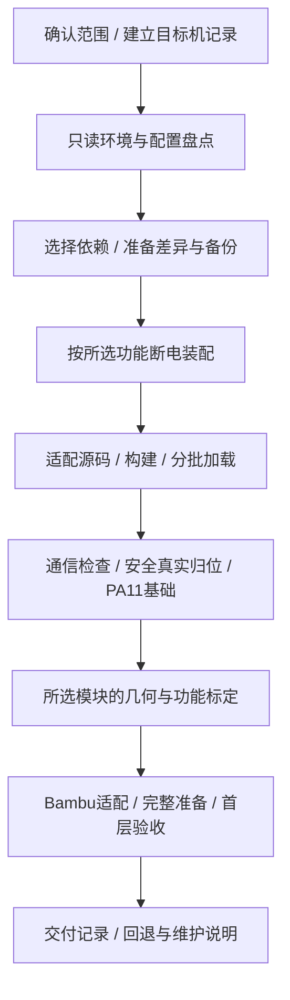

# 复刻总流程：从目标到验收

这是智能体实施复刻或扩展功能时的流程入口。先确定任务范围，再按阶段读取部署、校准步骤；实现参数留在专题文档及源码中。这里只整理方法，不代表第二台原装机器已完成整套验证。

路径以完整仓库为根。若仅安装了 skill，先取得本项目源码目录；不能把 skill 目录当成包含 source/config/slicer 的完整工程。

## P0：确认范围并建立目标机记录

1. 确认用户要完整复刻、增加某个模块、排错，还是仅整理资料。仅资料/只读任务不进入部署和实体测试；维护任务从相关阶段开始，不重新安装无关模块。
2. 获取目标机型/主板、地址与连接方式、当前工作状态、所选功能及已有硬件。信息暂缺时先完成不依赖它的本地分析，实体装配和运动条件由机器旁用户提供。
3. 在私有工作目录建立“目标机接手记录”，保存所选模块、实际软件/服务、逐文件差异、备份位置、机械标定、阶段状态和下一步。实际地址不提交公共仓库，密码不写记录。
4. 沿用本会话已明确的授权；需要用户协助时说明要检查/测量/观察什么。开始部署不自动授权无关调参、系统升级或完整方案之外的硬件动作。

接手记录的阶段状态使用“未开始 / 进行中 / 已验证 / 不适用”，每个已验证项附结果和版本；不适用项记录原因。记录“当前启动是否有真实三轴归位成功证据”，每次重启后使旧归位证据失效。接手记录不能代替实时机器状态。

## 第一层：阶段、产物和放行条件

图中阶段可按任务裁剪。例如仅元数据适配不需要拆机、归位或碰床；省略时记录“不适用”，不能把未做的验证记为通过。

| 阶段 | 输入与工作 | 完成证据 | 细分步骤 |
|---|---|---|---|
| P1 盘点 | 实际服务、解释器、厂商源码、配置 include、硬件与现有功能 | 可比较的目标基线和问题清单 | [部署指南 P1](deployment-and-integration.md#p1盘点实际环境与配置) |
| P2 准备 | 所选模块及依赖、目标文件、原有功能 | 逐文件差异、备份及配套回退方案，未知标定值单独列出 | [部署指南 P2](deployment-and-integration.md#p2选择依赖准备适配与备份) |
| P3 装配 | 对应物料、接线图、用户在场 | 断电装配确认、模块与线序信息；尚未运动的侧别只作待验证项 | [部署指南 P3](deployment-and-integration.md#p3由用户完成断电硬件装配) |
| P4 加载 | 接口兼容的改动、构建产物、备份 | 所选命令和配置加载成功；需要 MCU 时协议匹配且 Ready | [部署指南 P4](deployment-and-integration.md#p4构建合并与分批加载) |
| P5 基础 | 机器空闲、通信正常、安全归位条件 | 本次启动的真实 G28、PA11 基础及所选电气通道结果 | [校准指南 P5](commissioning-and-calibration.md#p5通信真实归位与基础检查) |
| P6 标定 | 基础已通过、目标机尺寸和基准 | 所选模块逐项功能/几何结果，缺项不能进入相关完整流程 | [校准指南 P6](commissioning-and-calibration.md#p6按所选模块逐项标定) |
| P7 打印 | 已适配的预设与必要模块已验收 | 实际生成 G-code、完整准备与首层结果；界面/结束状态证据 | [校准指南 P7](commissioning-and-calibration.md#p7切片完整准备与首层验收) |
| P8 交付 | 已验证与未验证项、部署版本和备份 | 使用方法、回退映射、目标机记录、后续限制 | [校准指南 P8](commissioning-and-calibration.md#p8交付恢复与后续接手) |

每个阶段只在其前置条件满足后进入。配置加载成功不是机械验收；离线模拟、无运动计划、UART、真实接触和实际打印应分别记录。阶段失败时回到该阶段的处理步骤，不能继续执行依赖失败结果的动作。

## 第二层：功能选择与依赖

先查[现成实现入口](../../../docs/implementation-reuse.md)或在控制电脑运行`python tools/reference_bundle.py <功能ID>`，取得所选源码、精确配置节和依赖，不遍历全仓库重新推导实现。`--with-dependencies`扩展现有实现依赖；`--config`只提取本地参考节，仍需按P2比较并保留目标参数。完整方案的自动范围resolver沿用ADXL注册；仅显式范围的温漂网格可用独立`mesh-drift`入口。

| 用户选择 | 必须一起处理的条件 | 仓库入口 | 实体验收入口 |
|---|---|---|---|
| 独立双 Z | 新驱动/独立接线、原 Z 配置、PA11、真实侧别与方向、丝杆几何 | `independent_dual_z.cfg` 的 Z 驱动/z_tilt/DUAL_Z_LEVEL 部分；无 ADXL 时不加载 PREPARE_WIPE 包装宏 | [P6 双 Z](commissioning-and-calibration.md#p61独立双-z) |
| 辅助/主风扇 | 对应接线、既有 fan 配置、M106/M107 路由、Bambu 输出 | `bambu_aux_fan.cfg` 及主 fan 比例映射 | [P5 电气检查](commissioning-and-calibration.md#p5通信真实归位与基础检查)及 P7 |
| 驱动散热 | FAN4 接线、电机列表、旧版空 heater 列表兼容 | `driver_cooling.cfg`，必要时合并 controller_fan 最小修正 | P5 电气检查；未装双 Z 时不引用不存在的 stepper_z1 |
| ADXL 喷嘴 offset | 工具头传感器、匹配 Tap Linux MCU/主机模块、PA11 同点基准、覆盖接触区域的床网 | `adxl345_z_offset.cfg`、Tap C/Python、相关解析模块 | [P6 ADXL](commissioning-and-calibration.md#p63adxl-喷嘴-offset) |
| 自动擦嘴与完整准备 | 擦嘴条/路径标定、热稳定、一次性会话；有双 Z 时处理包装宏加载顺序 | 开始代码、ADXL 配置与所选双 Z 包装 | [P6 擦嘴](commissioning-and-calibration.md#p62擦嘴位置与床网几何)、P6 ADXL、P7 |
| 自适应床网与参考温漂修正 | PA11、原生旧版床网/probe接口、可达中心、真实归位、范围解析入口；与ADXL同用时覆盖随机接触区域 | `adaptive_bed_mesh.cfg` 与 `adaptive_mesh_drift.py`；resolver 仍由ADXL注册 | [温漂模块D1～D5](adaptive-mesh-drift.md)、P6床网及P7；仅床网方案需独立适配resolver |
| autotune_tmc | 实际电机数据、Python/旧 Klipper 接口，不用近似电机名称代替规格 | 固定上游的适配源码与父配置 motor_constants | [P6 可选功能](commissioning-and-calibration.md#p64可选调参元数据与冷拔) |
| Bambu 元数据 | 目标 Moonraker 元数据接口、服务用户、预览目录权限 | `source/moonraker/metadata.py` 中必要差异 | P7 文件上传和界面，不需要运动 |
| 冷拔 | 辅助风扇、材料温度、挤出与行程限制、提示音输出 | `cold_pull.cfg` 或展开的维护 G-code | P6 可选功能，独立验收，不自动纳入每次打印 |

上述 cfg 均在 `config/reference/`。选择矩阵决定要加载哪些文件，不意味着逐个原样 include。父配置、同名宏及目标机状态仍须比较。

## 第三层：实现与故障资料

- 采购数量与分步装配：[采购与装配指南](../../../docs/bom-and-assembly.md)；引脚、照片和参考几何：[硬件说明](../../../docs/hardware.md)及[硬件决策摘要](hardware-and-geometry.md)。
- 旧环境、Linux MCU 构建与插件接口：[软件适配](../../../docs/software.md)及[软件/ADXL 摘要](software-and-adxl.md)。
- 热稳定、会话、随机点、床网和 offset 计算：[工作原理](../../../docs/features.md)。
- 预设与实际 G-code 差异：[切片说明](../../../docs/slicer.md)；验收与故障：[验收指南](../../../docs/validation.md)、[精选经验](../../../docs/lessons-learned.md)。

先读所处阶段，再读该阶段选中模块的专题。需要参数或异常分支时核对当前源码，不把历史经验文件整体当成部署指令。
